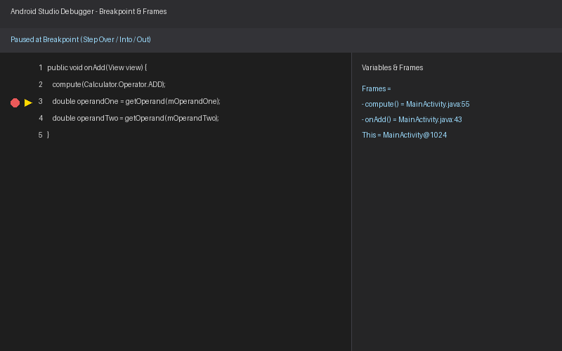
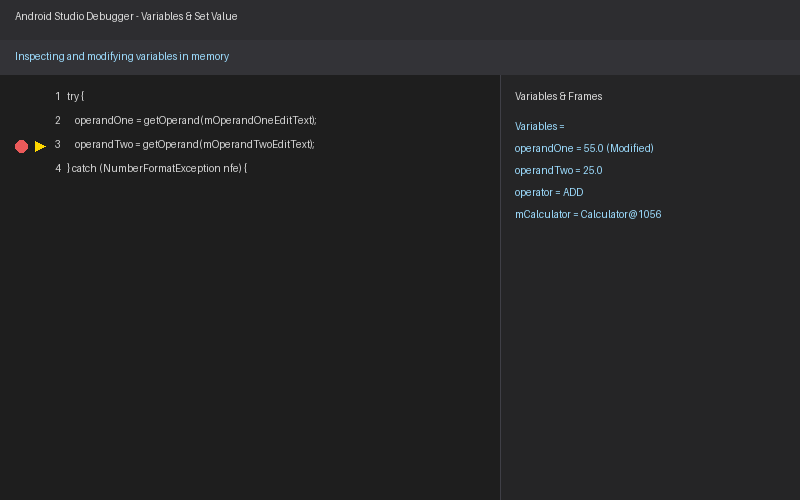
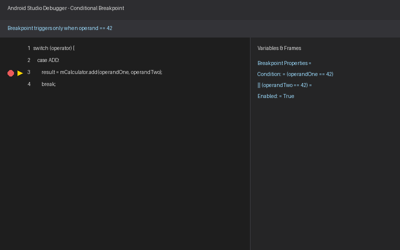
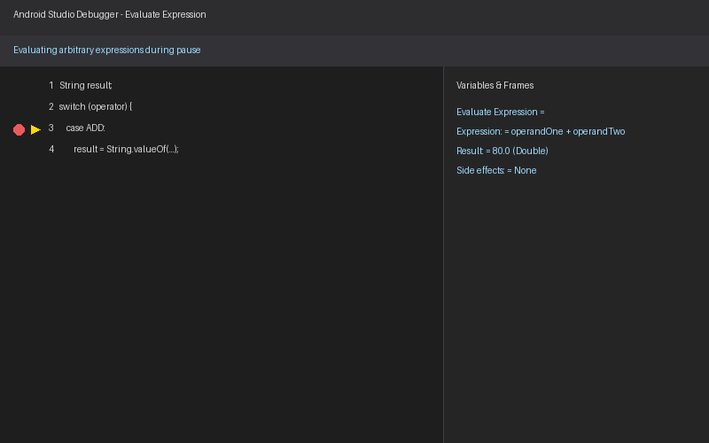
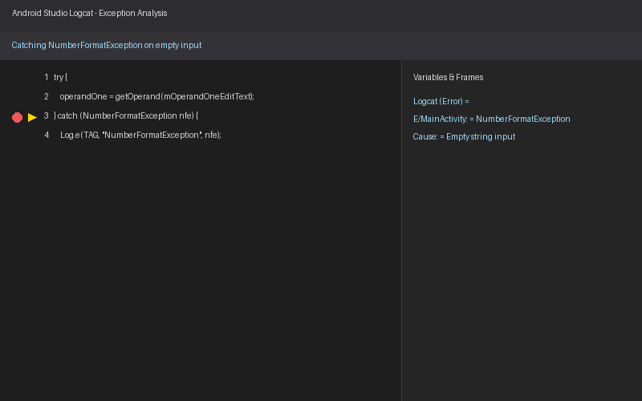
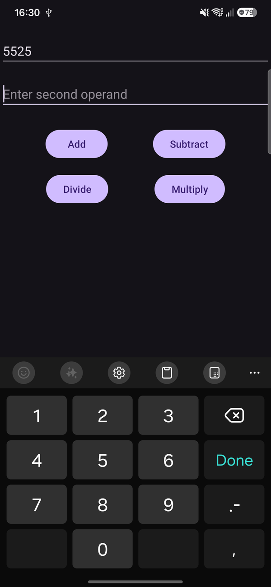

# SimpleCalc - Android Debugging Lab

SimpleCalc is an Android application developed with the assistance of an AI Agent to practice systematic debugging and troubleshooting in Android Studio according to the lab assignment.

## Debugging Screenshots & Proofs

### Breakpoint & Frames

### Variables & Set Value

### Conditional Breakpoint

### Evaluate Expression

### Logcat Exception Analysis

### App Running on Device

## Features & Debugging Topics Covered
- **Breakpoints & Conditional Breakpoints**
- **Step Over, Step Into, Step Out, Resume**
- **Variables, Watches & Set Value**
- **Evaluate Expression**
- **Logcat & Exception Handling (NumberFormatException)**
- **Edge cases (Division by zero, floating point precision)**
