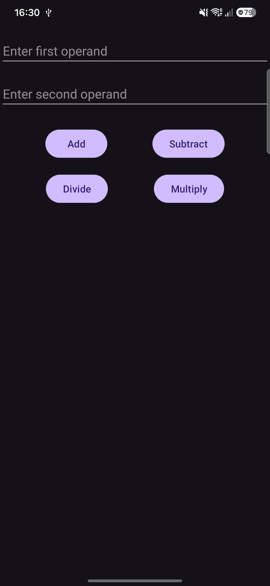

# SimpleCalc - Android Debugging Lab

SimpleCalc is an Android application developed to practice systematic debugging and troubleshooting in Android Studio.

## Screenshots

### App Startup

### Calculation Result (55 + 25 = 80.0)

## Features & Debugging Topics Covered
- **Breakpoints & Conditional Breakpoints**
- **Step Over, Step Into, Step Out, Resume**
- **Variables, Watches & Set Value**
- **Evaluate Expression**
- **Logcat & Exception Handling (NumberFormatException)**
- **Edge cases (Division by zero, floating point precision)**
