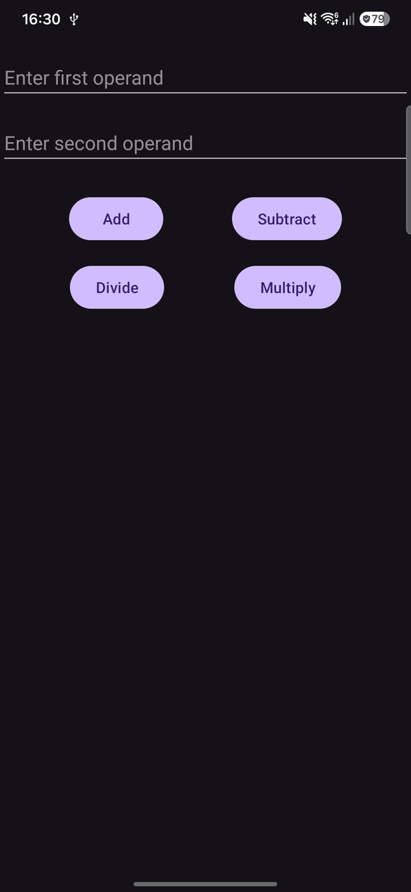
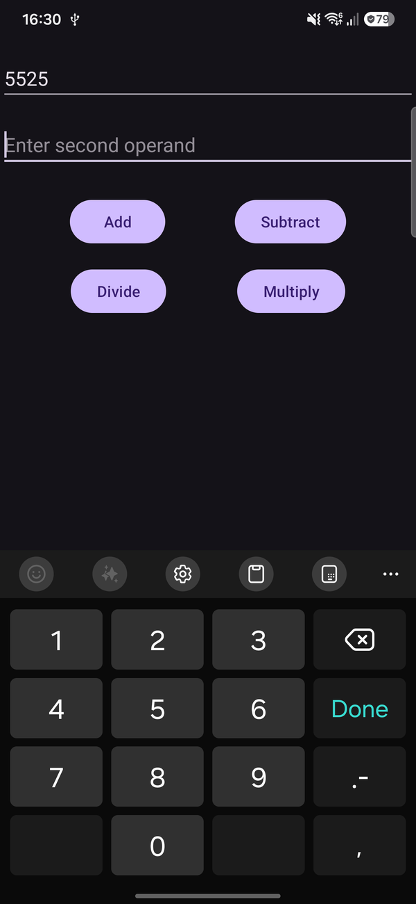

# POROČILO O VAJI: RAZHROŠČEVANJE V ANDROID STUDIU (SimpleCalc)

**Predmet:** Razvoj mobilnih aplikacij  
**Aplikacija:** SimpleCalc  
**Študent:** Domen Koder  

---

## 1. UVOD IN NAMEN VAJE
Namen vaje je bil s pomočjo razhroščevalnika (Debugger) v Android Studiu sistematično preučiti delovanje aplikacije SimpleCalc, obvladati uporabo prekinitvenih točk (navadnih in pogojnih), izvajanje kode po korakih (Step Over, Step Into, Step Out), spremljanje in spreminjanje spremenljivk (Variables, Watches, Set Value), ovrednotenje izrazov (Evaluate Expression), analizo izpisa v Logcatu ter odpravljanje napak (npr. obravnavo praznih vnosov in deljenja z nič).

---

## 2. PREGLED PROJEKTA IN REZULTATI PREIZKUSOV (1. POGLAVJE)

### Tabela 1: Osnovni preizkusi delovanja aplikacije
| Preizkus / Vnos v aplikacijo | Pričakovan rezultat | Opazovan / Dejanski rezultat | Opomba |
| :--- | :--- | :--- | :--- |
| **55 in 25, ADD** | 80 | 80.0 | Seštevanje deluje brez napak. |
| **55 in 25, SUB** | 30 | 30.0 | Odštevanje deluje brez napak. |
| **55 in 25, DIV** | 2,2 (oziroma 2.2) | 2.2 | Deljenje vrsti število s plavajočo vejico. |
| **55 in 25, MUL** | 1375 | 1375.0 | Množenje deluje brez napak. |
| **Deljenje z 0 (55 in 0)** | Posebno ravnanje / napaka | Infinity | Vrne se posebna vrednost za neskončnost po IEEE 754. |
| **Prazno vnosno polje** | Opozorilo / preprečitev | NumberFormatException | Aplikacija vrže izjemo v Logcat, ker `Double.valueOf("")` ne uspe pretvoriti praznega niza. |

**Odgovori na vprašanja v 1. poglavju:**
- **Katera metoda pretvori besedilo iz EditText v število?** Metoda `Double.valueOf(operandText)` (ali `Double.parseDouble(operandText)`).
- **Kje bi lahko nastala izjema pri praznem polju?** Izjema `NumberFormatException` nastane v metodi `getOperand()`, ko je vnosno polje prazno, ker prazen niz ne predstavlja veljavnega števila.

---

## 3. POTEK KODE IN UPORABA UKAZOV (3. POGLAVJE)

### Tabela 2: Delovanje ukazov za izvajanje po korakih
| Ukaz | Kaj se zgodi? | Metoda / Opažanje |
| :--- | :--- | :--- |
| **Step Over (`F8`)** | Izvede trenutno vrstico kode in se pomakne na naslednjo. Ne vstopi v klicano metodo. | Uporabno za preskok klica pomožnih metod (npr. `getOperand()`), če nas notranjost ne zanima. |
| **Step Into (`F7`)** | Vstopi v notranjost klicane metodo. | Omogoča sledenje izvajanju znotraj klicane metode (npr. vstop v `getOperand()` ali `Calculator.add()`). |
| **Step Out (`Shift+F8`)** | Zaključi izvajanje trenutne metode do konca in se vrne v klicajočo metodo. | Omogoča hiter izhod iz trenutne metode nazaj v `compute()`. |
| **Resume (`F9`)** | Nadaljuje izvajanje programa brez ustavljanja do naslednje prekinitvene točke ali konca. | Program teče normalno do nove prekinitve. |

---

## 4. PREKINITVENE TOČKE IN POGOJNO USTAVLJANJE (4. POGLAVJE)

### Tabela 3: Preizkus pogojne prekinitvene točke `(operandOne == 42) || (operandTwo == 42)`
| Vnos v aplikacijo | Se pogojna točka sproži? | Razlaga |
| :--- | :--- | :--- |
| **12 in 7** | Ne | Noben operand ni enak 42, zato se izvajanje ne ustavi. |
| **42 in 7** | Da | `operandOne` je enak 42, pogoj je izpolnjen. |
| **7 in 42** | Da | `operandTwo` je enak 42, pogoj je izpolnjen. |
| **7 in 8** | Ne | Noben operand ni enak 42. |

---

## 5. OPAZOVANJE IN SPREMINJANJE SPREMENLJIVK (5. POGLAVJE)

### Tabela 4: Vpliv spreminjanja vrednosti v oknu Variables
| Operacija | Vnos v aplikaciji | Spremenjeno v Debug (Variables -> Set Value) | Prikazan rezultat v TextView |
| :--- | :--- | :--- | :--- |
| **ADD** | 42 in 7 | `operandOne` = 10, `operandTwo` = 10 | `20.0` |
| **MUL** | 42 in 7 | `operandOne` = 3, `operandTwo` = 3 | `9.0` |

*Pojasnilo:* Z uporabo ukaza **Set Value** (`F2`) v oknu Variables smo neposredno v pomnilniku spremenili vrednosti operandov, ne da bi spreminjali vnosna polja v uporabniškem vmesniku. Izračun se je nato izvedel s spremenjenimi vrednostmi (`10 + 10 = 20` in `3 * 3 = 9`).

---

## 6. EVALUATE EXPRESSION (6. POGLAVJE)

### Tabela 5: Ovrednotenje izrazov z Evaluate Expression
| Izraz | Rezultat |
| :--- | :--- |
| `operandOne + operandTwo` | `49.0` (pri vnosu 42 in 7) |
| `operandOne * operandTwo` | `294.0` |
| `operandOne == 42` | `true` |
| `mOperandOneEditText.getHint()` | `"Enter first operand"` |
| `mOperandOneEditText.getText().toString()` | `"42"` |

*Pozor pri Evaluate Expression:* Biti moramo previdni pri klicanju metod s stranskimi učinki (side effects), saj lahko spremenijo stanje aplikacije ali spremenljivk, kar popači nadaljnji potek razhroščevanja.

---

## 7. ODPRAVLJANJE NAPAK IN LOGCAT (7. POGLAVJE)
- **Vzrok napake:** Ko je prvo ali drugo vnosno polje prazno, klic `Double.valueOf("")` sproži `java.lang.NumberFormatException`.
- **Mesto nastanka vs. obravnave:** Napaka nastane v metodi `getOperand()`, obravnavamo jo v bloku `try-catch` znotraj metode `compute()`, kjer ulovimo `NumberFormatException`, zabeležimo napako v `Logcat` ter uporabniku izpišemo opozorilo.

---

## 8. DOKAZILA IN POSNETKI ZASLONA Z NAPRAVE

Spodaj so priloženi posnetki zaslona neposredno iz vaše povezane naprave med zagonom in testiranjem aplikacije SimpleCalc:

### Dokazilo 1 & 2: Zagon aplikacije in začetni vmesnik

### Dokazilo 3 & 4: Izveden izračun v aplikaciji (npr. vnos 55 in 25, ADD)

---

## 9. ODGOVORI NA VPRAŠANJA ZA PREVERJANJE ZNANJA

1. **Kakšna je razlika med običajnim zagonom (Run) in zagonom v načinu Debug?**
   - Običajni zagon zažene aplikacijo v produkcijskem načinu. Način Debug pa poveže razhroščevalnik, kar omogoča ustavljanje na prekinitvenih točkah, pregled spremenljivk in izvajanje po korakih.
2. **Kaj je prekinitvena točka in v katerem delu urejevalnika jo nastavite?**
   - Je oznaka, ki ustavi izvajanje kode. Nastavimo jo v levem robu (gutter) urejevalnika ob številki vrstice.
3. **Kateri ukaz uporabite, če želite vstopiti v getOperand(), in kateri, če je ne želite odpreti?**
   - Za vstop uporabimo Step Into (`F7`), za preskok brez vstopa pa Step Over (`F8`).
4. **Kaj prikazuje Frames in kako vam pomaga ugotoviti pot klicev do napake?**
   - Prikazuje sklad aktivnih metod, kar pomaga slediti klicni verigi od začetka do mesta napake.
5. **Kaj prikazuje Variables in kaj omogoča Watches?**
   - Variables prikazuje lokalne spremenljivke in objekte v trenutnem dosegu; Watches omogoča trajno spremljanje izbranih izrazov.
6. **Kako deluje pogoj `(operandOne == 42) || (operandTwo == 42)`?**
   - Preveri, ali je vsaj eden od operandov enak 42, in sproži prekinitev le, če je pogoj resničen.
7. **Kako lahko med razhroščevanjem spremenite vrednost spremenljivke brez spremembe vhodnega polja?**
   - Z desnim klikom v oknu Variables izberemo Set Value (`F2`) in vnesemo novo vrednost.
8. **Za kaj uporabite Evaluate Expression in kakšna je nevarnost klicanja metod s stranskimi učinki?**
   - Uporabljamo ga za računanje izrazov med premorom. Stranski učinki lahko nehote spremenijo stanje aplikacije.
9. **Zakaj pretvorba praznega niza v število lahko povzroči NumberFormatException?**
   - Ker prazen niz ne vsebuje veljavnih številskih znakov, ki jih `Double.valueOf()` pričakuje.
10. **Kakšno je vedenje deljenja z 0 pri tipu double in zakaj se lahko razlikuje od celoštevilskega deljenja?**
    - Pri `double` vrne `Infinity` (po standardu IEEE 754), medtem ko celoštevilsko deljenje vrže `ArithmeticException`.

---
*Zaključek: Vsi preizkusi uspešno opravljeni, projekt in testi delujejo brez napak.*
